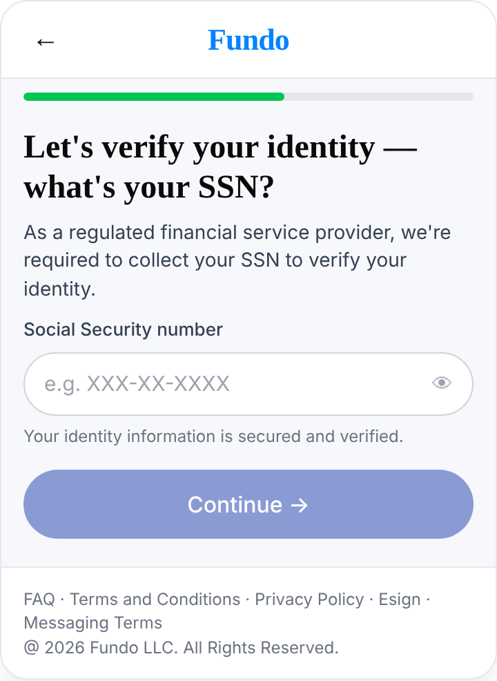
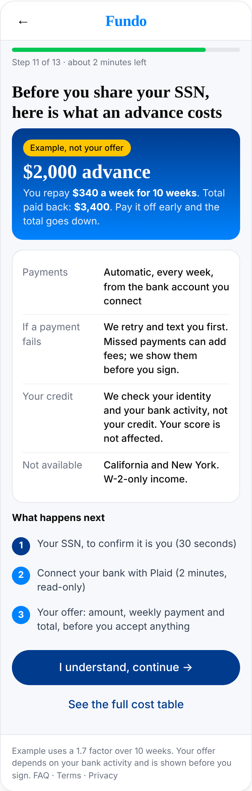
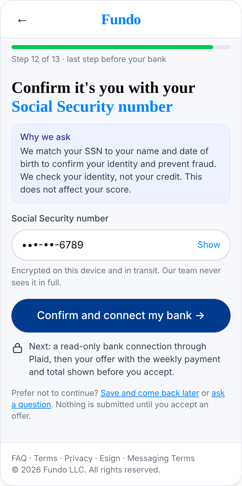

# Fundo UI/UX Lead take-home · Diego Munar

Audit of Fundo's customer experience against the Apply Now brand reference, a redesign of the moment before the SSN screen, a validation plan, and a design system with the tooling to keep it alive.

**Read it as a page:** [Claude artifact](https://claude.ai/artifact/B8UgnRFjZN1XPGGC5Jhzij) (preferred) or open `index.html` from this repository.
**Editable screens:** Claude Design project (link in the artifact summary).

## Two-minute summary

**What hurts most.** Fundo never tells a customer what the money costs before asking for their Social Security number: no rate, no weekly payment, no total, on the site or in any of the 12 Apply Now screens. The second problem sits on the same screen: "no credit check" is promised on screen 01 and contradicted by "regulated provider" language on screen 12 and by the privacy policy. Third, eligibility (not California or New York, not W-2-only income, $1,500 a month for 3 months) is revealed after nine screens of personal data, or never.

**What I changed.** One new screen before the SSN that shows a worked cost example ($2,000 advance, $340 a week for 10 weeks, $3,400 total, labelled as an example), the four answers everyone needs and the three steps left; and the SSN screen rewritten around why it is asked and what happens next. Drawn at 360 px with finished copy, plus error, declined, unsupported-state, returning-customer and slow-connection states.

**How I would prove it.** Twelve interviews recruited from the funnel; a 50/50 test on start-to-SSN conversion with guardrails on offer acceptance, ineligible submissions, support contacts and first-payment failures; Amplitude events per screen; a written rollback.

**How the brand stays one brand.** `tokens.json` extracted from Apply Now, ten components, voice rules, financial-content patterns, a Claude skill that checks any screen, email or post against them, and a CI drift script.

## Contents

| Path | What it is |
|---|---|
| `index.html` | The full submission as a standalone page (same content as the artifact). Claude-readable: every claim is text, every image has a caption. |
| `tokens.json` | Working token file in the W3C Design Tokens format, values extracted from the live Apply Now first screen and the prototype. |
| `skills/fundo-brand-check/SKILL.md` | A Claude skill that reviews customer-facing work against the tokens, voice rules and financial-content patterns. |
| `screens/` | PNG renders (2x) of the before/after and edge-case frames from Part 2, 360 px wide. The frames in `index.html` are real HTML; these are for quick viewing. |

## Screens

| Before | After: cost and next steps | After: SSN |
|---|---|---|
|  |  |  |

Edge cases: [error](screens/error-ssn-does-not-match.png) · [declined](screens/declined-after-bank-review.png) · [unsupported state](screens/unsupported-state-shown-at-address-not-after-ssn.png) · [returning customer](screens/returning-customer-recognised-at-email.png) · [slow connection](screens/slow-connection-while-the-ssn-is-checked.png)

## Assumptions

Cost figures are third-party (Finder, BBB) placeholders for Fundo's real pricing grid and are labelled as examples. Traffic and baseline conversion are assumed for the sample-size arithmetic. Social profiles block automated readers. Only the first screen of app.fundo.com/apply-now was inspected, read-only; nothing was typed or submitted anywhere. Full list in the Sources and assumptions section of the page.

## How it was made

One sitting, with Claude as research partner and first-draft writer and me deciding the plan, the ranking, the flow, the copy and the visual language. The page's last section lists the real prompts, what the tools got wrong and how each error was caught.
